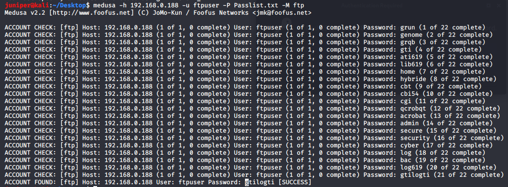
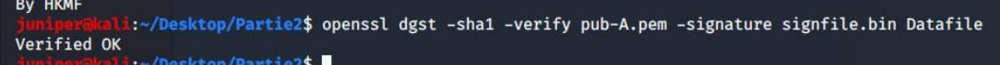
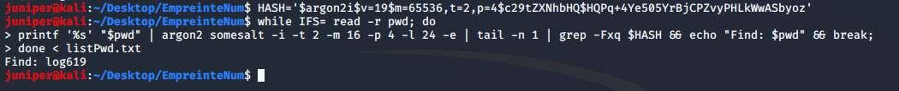
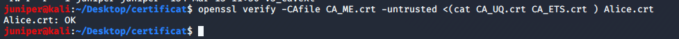
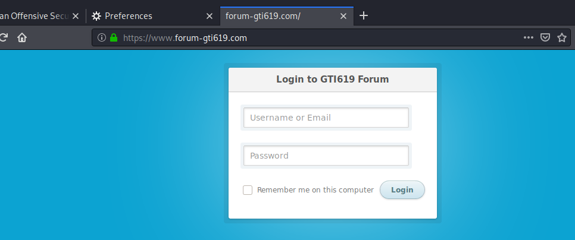

# Lab 4: applied cryptography and PKI with OpenSSL

A hands-on cryptography lab done in a university security lab (security of systems, ÉTS, Montréal, winter 2026). It covers symmetric and asymmetric encryption, a hybrid scheme, digital signatures, password hashing and cracking, a full certificate chain, and enabling TLS on a web server. Almost everything runs through OpenSSL, with Medusa and the `argon2` CLI for the two offensive parts.

Lab done in a team of 4. Write-up and reformulation by Ilyas El Houdaigui. No teammate names or student IDs are included.

French version: [README.fr.md](README.fr.md).

Contents:

1. [Symmetric encryption](#symmetric-encryption)
2. [Asymmetric and hybrid encryption](#asymmetric-and-hybrid-encryption)
3. [Password hashing with Argon2](#password-hashing-with-argon2)
4. [Certificate chain and authentication](#certificate-chain-and-authentication)
5. [Enabling TLS on a web server](#enabling-tls-on-a-web-server)
6. [Tools used](#tools-used)
7. [Technique and good-practice summary](#technique-and-good-practice-summary)

The two attacks (the FTP brute force and the Argon2 crack) map to MITRE ATT&CK T1110. The rest is constructive cryptography, so the useful notes there are about which choices are safe and which are not.

---

## Symmetric encryption

### Getting the files: FTP brute force

The encrypted files sat on an FTP server. The account `ftpuser` was found by trying a wordlist with Medusa:

```
medusa -h 192.168.0.188 -u ftpuser -P Passlist.txt -M ftp
```

Password: `gtilogti`. Logging in to `ftp://192.168.0.188` then gave access to the folders holding the exercise files (symmetric, asymmetric, hybrid, and hashing). This is online password guessing (T1110.001).



### Encrypting a file (AES-128-CBC)

```
openssl enc -aes-128-cbc -pbkdf2 -salt -in techData -out techData.enc
```

AES-128 in CBC mode. `-pbkdf2` derives the key from the passphrase with a proper key-derivation function instead of a plain hash, and `-salt` adds a random salt so the same passphrase does not produce the same ciphertext twice.

### Decrypting (Camellia-128-ECB)

```
openssl enc -d -camellia-128-ecb -pbkdf2 -iter 200000 -in RHSecret -out RHSecret.dec
```

Camellia is a solid block cipher, but ECB is the weak part: it encrypts each block independently, so identical plaintext blocks give identical ciphertext blocks and patterns leak. It shows up here as an exercise, not as something to use for real data.

### Layered decryption (ARIA then AES)

One file was encrypted twice, so it comes off in two passes, outer layer first:

```
openssl enc -d -aria-256-cbc -pbkdf2 -in SecretDT -out temp1
openssl enc -d -aes-128-cbc -pbkdf2 -in temp1 -out BankDT
```

---

## Asymmetric and hybrid encryption

### RSA key pair

```
openssl genrsa -out priv-C.pem 2048
openssl rsa -in priv-C.pem -pubout -out pub-C.pem
```

A 2048-bit private key, with the public key extracted from it.

### Decrypting with the recipient's private key

A file encrypted to Bob's public key is recovered with Bob's private key:

```
openssl pkeyutl -decrypt -in cryptofile.bin -out Datafile -inkey priv-B.pem
```

### Verifying a signature

```
openssl dgst -sha1 -verify pub-A.pem -signature signfile.bin DataFile
# Verified OK
```

`Verified OK` confirms the file was signed by Alice and has not changed. The signature uses SHA-1 here because that is what the lab provided. For anything real, SHA-1 is broken for signatures and SHA-256 or better should be used.



### Hybrid encryption

RSA cannot encrypt large data directly, so the usual pattern is hybrid: a random symmetric session key encrypts the data, and RSA encrypts only that session key.

Decrypting (recover the session key with the private key, then use it on the file):

```
openssl pkeyutl -decrypt -in cle.key -out clekeydechifre.txt -inkey privA.pem
openssl enc -d -aes-128-ecb -in LabSecret -out LabData -K e0e0e0e0f1f1f1f1
```

Encrypting the other direction (Alice to Bob), with a signed message:

```
openssl rand -out session.key 32
openssl enc -aes-256-cbc -salt -in LabData.sig -out LabData.sig.enc -pass file:./session.key
openssl rsautl -encrypt -pubin -inkey pub-B.pem -in session.key -out session.key.enc
```

Bob reverses it: `rsautl -decrypt` with his private key to get the session key, `enc -d -aes-256-cbc` to get the signed message back, then `dgst -verify` against Alice's public key, which returns `Verified OK`.

This one exchange gives the four properties at once:

- Confidentiality: the session key is wrapped with Bob's public key, so only Bob can read the message.
- Integrity: the signature is computed over the exact bytes, so any change breaks verification.
- Authenticity: only Alice holds the private key that made the signature.
- Non-repudiation: because of that, Alice cannot later deny signing it.

---

## Password hashing with Argon2

### Reading the parameters

After decrypting the protected file, its contents describe an Argon2 hash:

```
openssl enc -d -a -camellia-128-ecb -pbkdf2 -in Securefile -out Securefile_open -pass pass:argon
```

The record: variant Argon2i, 2 iterations, 65536 KiB (64 MiB) of memory, parallelism 4, plus the raw hash and the full encoded string.

### Cracking by dictionary

The attack recomputes Argon2 for every candidate in `ListPwd.txt` with the same parameters and compares against the target encoded hash:

```bash
HASH='$argon2i$v=19$m=65536,t=2,p=4$c29tZXNhbHQ$HQPq+4Ye505YrBjCPZvyPHLkWwASbyoz'
while IFS= read -r pwd; do
  printf '%s' "$pwd" | argon2 somesalt -i -t 2 -m 16 -p 4 -l 24 -e | tail -n 1 \
    | grep -Fxq "$HASH" && echo "Find: $pwd" && break
done < ListPwd.txt
# Find: log619
```

The password is `log619` (T1110.002, offline password cracking). The point of Argon2 is exactly that each guess costs real memory and time, which makes large-scale cracking expensive. It only fell quickly here because the wordlist was tiny.



---

## Certificate chain and authentication

The goal was to build a three-level PKI and validate it. Each level signs the one below, up to a self-signed root.

```
# Root CA (self-signed)
openssl genpkey -algorithm RSA -out CA_ME.key -pkeyopt rsa_keygen_bits:2048
openssl req -x509 -new -key CA_ME.key -sha256 -days 3650 -out CA_ME.crt -subj "/CN=CA_MELS"

# Intermediate CA_UQ, signed by the root
openssl genpkey -algorithm RSA -out CA_UQ.key -pkeyopt rsa_keygen_bits:2048
openssl req -new -key CA_UQ.key -out CA_UQ.csr -subj "/CN=CA_UQ"
openssl x509 -req -in CA_UQ.csr -CA CA_ME.crt -CAkey CA_ME.key -CAcreateserial -out CA_UQ.crt -days 3650 -sha256 -extfile v3_ca.ext

# Issuing CA_ETS, signed by CA_UQ (same pattern)
# Leaf certificate for Alice, signed by CA_ETS (same pattern), CN=Alice
```

Validate the chain from Alice up to the root, passing the intermediates as untrusted:

```
openssl verify -CAfile CA_ME.crt -untrusted <(cat CA_UQ.crt CA_ETS.crt) Alice.crt
# Alice.crt: OK
```



The same root anchors a signed-document check with CMS. Bob signs a file, bundling the intermediates, and the verifier rebuilds the chain to the root:

```
openssl cms -sign -in tp_bob_unsigned -signer Bob.crt -inkey Bob.key \
  -certfile <(cat CA_UQ.crt CA_ME.crt) -out tp_bob_signed.pem -outform PEM -nodetach
openssl cms -verify -inform PEM -in tp_bob_signed.pem -CAfile CA_ME.crt -out tp_bob_recovered
# Verification successful
```

---

## Enabling TLS on a web server

Generate the server key and a certificate signing request:

```
openssl req -newkey rsa:2048 -nodes -keyout forum.key -out forum.csr \
  -subj "/C=CN/ST=QUEBEC/L=MONTREAL/O=ETS/OU=DSI/CN=www.forum-gti619.com"
```

Create a CA and sign the server certificate with it:

```
openssl req -new -x509 -days 3650 -key ca.key -out ca.crt \
  -subj "/C=CN/ST=QUEBEC/L=MONTREAL/O=ETS/OU=DSI/CN=CA-GTI619"
openssl x509 -req -days 365 -in forum.csr -CA ca.crt -CAkey ca.key -CAcreateserial -out forum.crt
```

Wire it into Apache and force HTTPS:

```
sudo a2enmod ssl headers
sudo a2ensite default-ssl
sudo cp forum.key /etc/ssl/private/forum.key
sudo cp forum.crt /etc/ssl/certs/forum.crt
sudo chmod 600 /etc/ssl/private/forum.key
# default-ssl.conf: SSLCertificateFile /etc/ssl/certs/forum.crt
#                   SSLCertificateKeyFile /etc/ssl/private/forum.key
# 000-default.conf: Redirect permanent / https://www.forum-gti619.com/
sudo systemctl restart apache2
```

After the restart, plain HTTP redirects to HTTPS and the forum login page is served over TLS with the padlock showing.



---

## Tools used

- OpenSSL for everything cryptographic: `enc`, `genrsa` and `genpkey`, `rsa`, `pkeyutl`, `rsautl`, `dgst`, `req`, `x509`, `cms`, and `verify`.
- Medusa for the FTP brute force.
- The `argon2` CLI inside a Bash loop for the dictionary attack.
- Apache (`a2enmod`, `a2ensite`) to serve the site over TLS.

## Technique and good-practice summary

| Part | Note | Reference |
|------|------|-----------|
| FTP brute force (Medusa) | Online password guessing | T1110.001 |
| Argon2 dictionary attack | Offline password cracking | T1110.002 |
| ECB mode (Camellia, AES) | Leaks plaintext patterns, avoid it | prefer an authenticated mode (AES-GCM) |
| SHA-1 signatures | Broken for signatures | use SHA-256 or stronger |
| Key derivation | PBKDF2 or Argon2 with high cost | the OpenSSL "deprecated key derivation" warnings point here |
| Private key handling | `chmod 600`, never world-readable | least privilege |
| PKI validation | Verify the full chain to a trusted root | `openssl verify` with the intermediates |

## Note on scope and ethics

This was done on lab machines set up for the exercise. The passwords, keys, and certificates shown belong to that disposable environment and have no value anywhere else. The brute force and the hash cracking were run only against the lab's own files.
