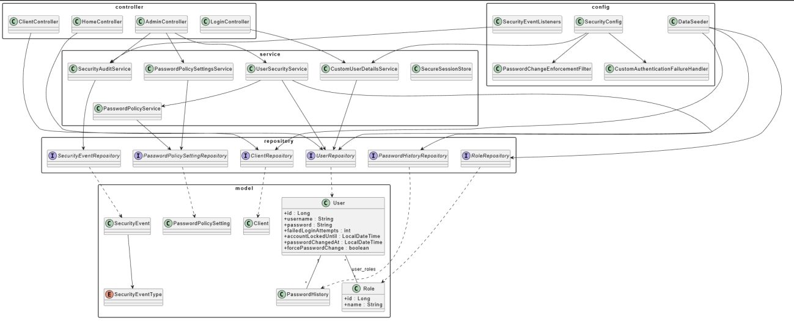
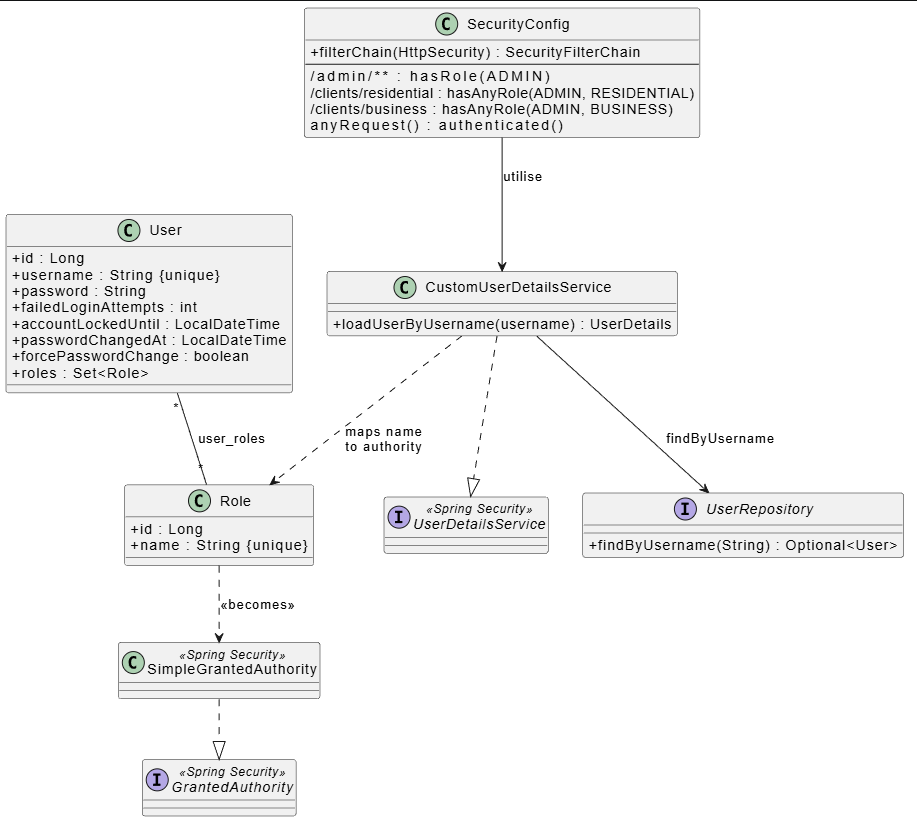
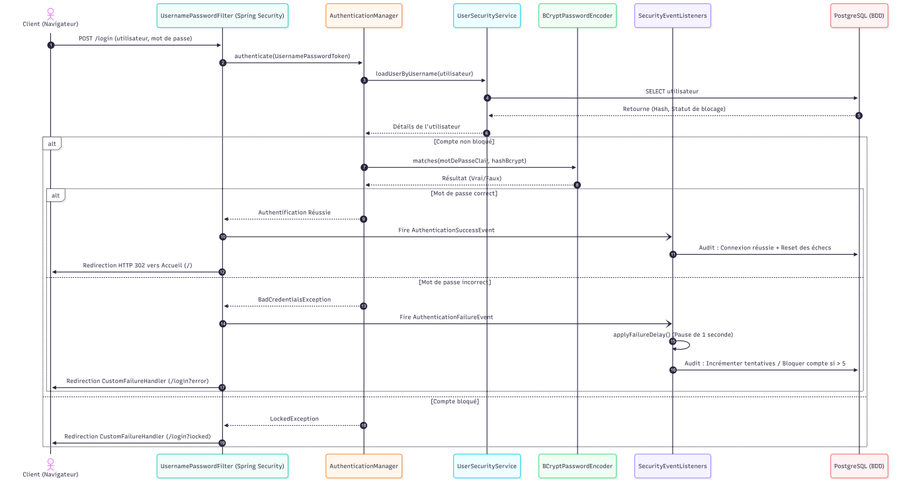

# Labo 5 : authentification sécurisée dans une application web Spring Boot

Ce labo est le pendant défensif des autres. Au lieu d'attaquer un système, l'équipe en a construit un : une application web conçue dès le départ autour de l'authentification, du contrôle d'accès basé sur les rôles et de la protection des sessions. Il a été réalisé dans un labo universitaire de sécurité des systèmes, ÉTS (Montréal), hiver 2026, avec Spring Boot et Spring Security.

Labo réalisé en équipe de 4, write-up et reformulation par Ilyas El Houdaigui. Aucun nom ni matricule des coéquipiers n'est inclus.

English version: [README.md](README.md).

Sommaire :

1. [Architecture](#architecture)
2. [Contrôle d'accès (RBAC)](#contrôle-daccès-rbac)
3. [Authentification et politique de mots de passe](#authentification-et-politique-de-mots-de-passe)
4. [Gestion des sessions](#gestion-des-sessions)
5. [Forces et limites](#forces-et-limites)
6. [Contrôles et ce contre quoi ils protègent](#contrôles-et-ce-contre-quoi-ils-protègent)
7. [Stack](#stack)

---

## Architecture

Une application client-serveur MVC en trois couches. Le navigateur parle au serveur uniquement en HTTPS, appuyé sur un keystore PKCS#12. Le serveur est une application Spring Boot autonome qui rend le HTML côté serveur avec Thymeleaf, et la persistance passe par Spring Data JPA et Hibernate sur PostgreSQL.

Les trois couches du back-end :

- Présentation : contrôleurs Spring MVC et gabarits Thymeleaf.
- Service : services transactionnels qui portent la logique de sécurité (politique de mots de passe, audit, attributs de session chiffrés, gestion des utilisateurs).
- Persistance : entités JPA et repositories Spring Data.

La sécurité transversale est centralisée dans un paquet de configuration via Spring Security 6.

La stack et le pourquoi de chaque brique :

| Choix | Pourquoi |
|-------|----------|
| Java 21 + Spring Boot 4 | Écosystème mature, support natif de BCrypt, CSRF et gestion de session. |
| Spring Security 6 | Fournit les primitives exigées (RBAC, protection de session, filtres d'authentification, BCrypt, CSRF par défaut) sans réécrire du code de sécurité critique. |
| Thymeleaf (rendu côté serveur) | Aucune surface d'API JSON et aucun état d'authentification en JavaScript, ce qui réduit la surface XSS et vol de token. |
| PostgreSQL | Base relationnelle transactionnelle avec les contraintes d'intégrité nécessaires (unicité des noms d'utilisateur, clés étrangères des rôles). |
| Spring Data JPA / Hibernate | Retire le SQL manuel de la couche métier, ce qui ferme l'injection SQL par défaut. |
| HTTPS via PKCS#12 | Chiffre le trafic en transit ; le keystore est embarqué pour simplifier la démo. |
| BCrypt (force 12) | Hash adaptatif avec un sel par utilisateur intégré. |

---

## Contrôle d'accès (RBAC)

Le modèle est constitué de trois entités JPA : `User`, `Role`, et la table de jonction `user_roles`, dans une relation plusieurs-à-plusieurs. Les rôles sont chargés en EAGER pour que les autorités Spring Security soient prêtes dès le chargement de l'utilisateur. Trois rôles et trois utilisateurs sont créés au démarrage par un `DataSeeder`, avec des mots de passe hachés par BCrypt (force 12) avant insertion.

| Rôle stocké | Autorité Spring Security | Fonction |
|-------------|--------------------------|----------|
| ROLE_ADMIN | ADMIN | Administrateur |
| ROLE_RESIDENTIAL | RESIDENTIAL | Préposé aux clients résidentiels |
| ROLE_BUSINESS | BUSINESS | Préposé aux clients d'affaires |

Toutes les règles d'accès sont au même endroit, `SecurityConfig.filterChain` :

| URL | Rôles autorisés |
|-----|-----------------|
| /login | public |
| / | tout utilisateur authentifié |
| /admin/** | ADMIN uniquement |
| /clients/residential | ADMIN + RESIDENTIAL |
| /clients/business | ADMIN + BUSINESS |
| /security/change-password | tout utilisateur authentifié |
| /logout | authentifié |

La dernière règle est `anyRequest().authenticated()`, donc l'application est fail-closed : une nouvelle URL est protégée tant que quelqu'un ne l'ouvre pas explicitement. Thymeleaf masque les liens qu'un utilisateur n'a pas le droit de suivre, mais la règle serveur reste la seule source de vérité, donc masquer un lien n'est jamais le vrai contrôle.

Ce qui fonctionne bien ici : les règles sont centralisées et déclaratives, donc un changement s'applique partout d'un coup ; le défaut est le refus ; et les contraintes de base (unicité de `users.username` et `roles.name`, clés étrangères sur `user_roles`) empêchent les données incohérentes. Ce que je changerais : les rôles sont codés en dur dans `SecurityConfig`, donc en ajouter un demande un redémarrage. Une hiérarchie de rôles (`ROLE_ADMIN > ROLE_RESIDENTIAL`) retirerait les `hasAnyRole(ADMIN, ...)` répétés et le risque d'oublier l'admin dans une règle. Charger les rôles en EAGER à chaque requête convient pour une poignée de rôles mais demanderait un cache à l'échelle.

---

## Authentification et politique de mots de passe

Les mots de passe sont stockés avec BCrypt en force 12, soit 2^12 (4096) tours par hash. BCrypt génère un sel aléatoire par utilisateur, donc deux utilisateurs avec le même mot de passe obtiennent des hashs complètement différents, ce qui met en échec les rainbow tables précalculées (CWE-916, CWE-759). Le facteur de travail élevé est ce qui ralentit le cassage hors ligne.

La politique autour de la connexion et des mots de passe :

- Défense contre le brute force : un délai d'une seconde à chaque échec, et un verrouillage permanent après cinq échecs qui demande un administrateur pour être levé (CWE-307).
- Expiration : les mots de passe doivent être changés tous les 90 jours.
- Complexité : au moins 12 caractères avec une majuscule, un chiffre et un caractère spécial.
- Historique : les cinq derniers mots de passe sont conservés et ne peuvent pas être réutilisés.

Les événements de sécurité sont enregistrés par un `SecurityAuditService` dédié et des écouteurs d'événements, qui journalisent les échecs de connexion, les verrouillages de compte et les changements de mot de passe, chacun lié à un utilisateur, et les affichent sur le tableau de bord administrateur (CWE-778).

Les opérations critiques exigent une nouvelle preuve d'identité. Quand un administrateur réinitialise le mot de passe d'un client, `adminResetPassword` revérifie le mot de passe actuel de l'administrateur avant de s'exécuter, ce qui limite les dégâts si une session reste ouverte sur un poste déverrouillé.

---

## Gestion des sessions

Le cookie de session (`JSESSIONID`) est protégé contre la fixation, le rejeu et l'exposition côté client :

- Fixation de session : un nouvel identifiant est émis à chaque connexion (`sessionFixation().migrateSession()`), donc un identifiant pré-imposé est inutile (CWE-384).
- `HttpOnly` : JavaScript ne peut pas lire le cookie, ce qui atténue le vol via XSS (CWE-1004).
- `Secure` : le cookie ne circule qu'en HTTPS (CWE-614).
- `SameSite=Strict` : le cookie n'est jamais envoyé en cross-site, ce qui couvre le CSRF (CWE-352).
- `tracking-modes=cookie` : l'identifiant de session n'apparaît jamais dans une URL.
- `invalidSessionUrl` : une requête avec un identifiant de session inconnu est rejetée.
- `maximumSessions(1)` : une nouvelle connexion invalide la session précédente.

Les attributs sensibles ne restent pas en clair dans la session. Ils passent par un `SecureSessionStore` qui chiffre les valeurs avec AES-GCM (un IV aléatoire de 12 octets et un tag de 128 bits) avant leur entrée dans la `HttpSession`. La clé est dérivée par SHA-256 à partir d'un secret fourni via la variable d'environnement `SESSION_SECRET`, et les seules méthodes exposées sont `putConfidential()` et `getConfidential()`. Un dump mémoire de la session ne montre rien d'utile en clair, et AES-GCM détecte aussi toute altération de la valeur stockée.

---

## Forces et limites

La conception s'appuie sur la défense en profondeur : TLS en transit, BCrypt au repos, verrouillage et délai contre le brute force, autorisation fail-closed, cookies de session durcis, et chiffrement applicatif des données de session sensibles, le tout construit sur Spring Security plutôt que du code maison.

Les limites honnêtes, dont la plupart sont relevées par le rapport lui-même :

- Les sessions vivent en mémoire JVM, donc elles sont perdues au redémarrage et ne passent pas à l'échelle sur plusieurs instances. Spring Session avec Redis corrigerait cela.
- Le secret de chiffrement de session a une valeur statique par défaut qui doit être remplacée en production, idéalement depuis un gestionnaire de secrets comme Vault, et le faire tourner implique un redémarrage et la perte de toutes les sessions actives.
- Le verrouillage permanent après cinq échecs est lourd. Un chemin de récupération en libre-service (OTP) allégerait la charge de l'admin.
- Il n'y a aucun contrôle comportemental (un changement d'IP ou de User-Agent ne déclencherait rien), ni moyen de révoquer les sessions de façon centralisée depuis une vue admin.
- Le timeout de 30 minutes peut être trop long pour des rôles sensibles.

---

## Contrôles et ce contre quoi ils protègent

| Contrôle dans l'application | Protège contre | Référence |
|-----------------------------|----------------|-----------|
| BCrypt force 12 avec sel par utilisateur | Stockage de mot de passe faible ou sans sel | CWE-916, CWE-759 |
| Verrouillage après 5 échecs + délai 1s | Brute force | CWE-307 |
| Identifiant de session régénéré à la connexion | Fixation de session | CWE-384 |
| Cookie HttpOnly | Vol de cookie via XSS | CWE-1004 |
| Cookie Secure | Cookie envoyé en clair | CWE-614 |
| SameSite=Strict | Cross-site request forgery | CWE-352 |
| RBAC fail-closed dans SecurityConfig | Autorisation manquante ou incorrecte | CWE-862, CWE-863 |
| Audit des événements de sécurité | Journalisation insuffisante | CWE-778 |
| Accès JPA / paramétré | Injection SQL | CWE-89 |

## Stack

Java 21, Spring Boot 4, Spring Security 6, Thymeleaf, PostgreSQL, Spring Data JPA / Hibernate, BCrypt, AES-GCM, et un keystore PKCS#12 pour le TLS.

## Note sur le périmètre

Ce labo était une construction défensive sur des machines de labo montées pour l'exercice. Aucune attaque n'a été menée contre qui que ce soit. Le write-up documente la conception de sécurité pour que les choix puissent être jugés et réutilisés.
